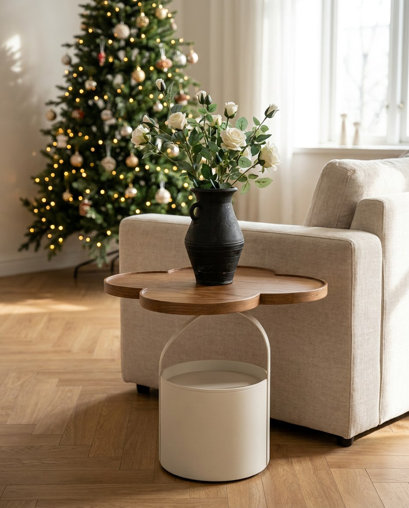
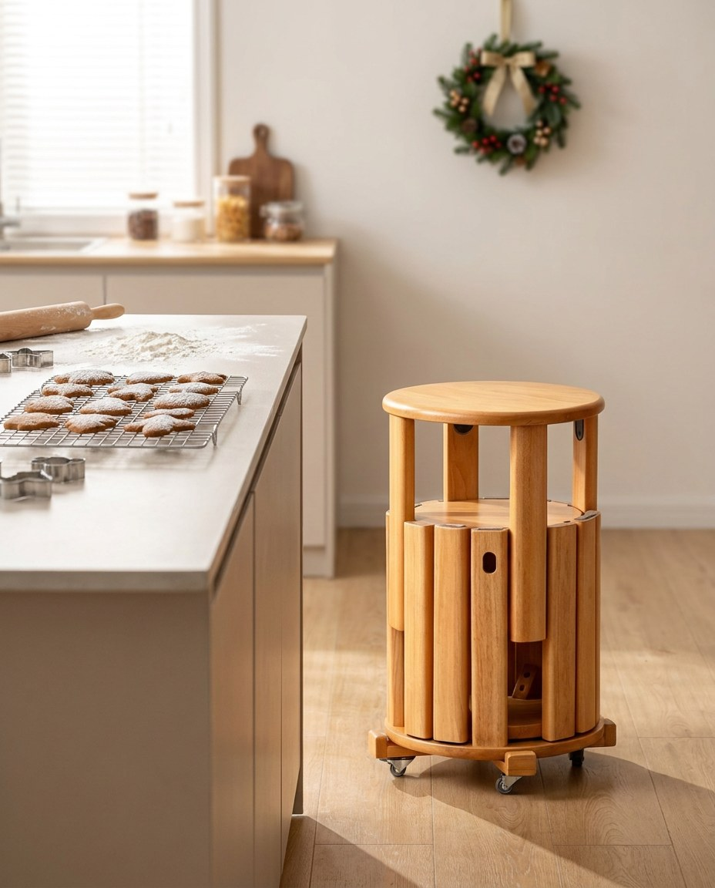

# 🎄 Kampania „Święta z drewnem FUDALI” (13.11 – 13.12.2026)

**Status:** 👀 do akceptacji Pablo – nic nie wyjdzie bez Twojej zgody. Po akceptacji: szkice w Metricool (potrzebne publiczne linki do grafik) albo wklejenie ręczne z tego pliku.
**Cel:** sprzedaż prezentów ze sklepu https://www.fudali.com.pl/sklep/ przed świętami.
**Pomysł:** prezenty z drewna na każdy budżet – **od 49 do 1 200 zł** – pokazane w ciepłych, świątecznych scenach.
**Grafiki:** Zosia, zdjęcia produktów z fudali.com.pl umieszczone w nowej scenerii (AI, model Gemini 3 Pro Image).
Produkt na każdym zdjęciu został sprawdzony z oryginałem. Na Instagramie posty oznaczone jako „AI”, zgodnie z zasadami IG.

## Jak wyprzedzamy rywali
- **Bogateco / Płoty Ogrodowe** sprzedają w święta dekoracje z wikliny i dodatki z juty za 5–20 zł. My sprzedajemy **prezenty użytkowe z litego drewna**:
  rzeczy, które zostają na lata, a nie dekoracje na 3 tygodnie. W każdym poście jasna cena i link.
- **Ecofurn (EcoChair)** – za granicą ich leżak kosztuje 147–237 CHF, a poduszkę kupuje się osobno. Nasz kosztuje **299 zł z poduszką**
  (Pinterest/Etsy po angielsku: „cushion included”).
- Tempo: 2 posty tygodniowo o najlepszych godzinach (Metricool: pt 10:00, wt 18:00) + stories.

## Plan
| Data (Warszawa) | Produkt | Cena | Grafika | Status |
|---|---|---|---|---|
| pt 13.11, 10:00 | Podkładka-kwiat z orzecha czarnego | 99 zł | podkladka.jpg | 👀 gotowe – do akceptacji |
| wt 17.11, 18:00 | Otwieracz „Kot” | 49 zł | otwieracz-kot.jpg | 👀 gotowe – do akceptacji |
| pt 20.11, 10:00 | Stolik boczny „Płatek”, dąb czerwony | 850 zł | stolik-platek.jpg | 👀 gotowe – do akceptacji |
| wt 24.11, 18:00 | Składany stolik z litego drewna | 229 zł | stolik-skladany.jpg | 👀 gotowe – do akceptacji |
| pt 27.11, 10:00 (Black Friday) | Leżak pod choinkę | 299 zł | lezak-pod-choinka.jpg | 👀 gotowe – do akceptacji |
| wt 1.12, 18:00 | Zestaw stołków z wózkiem, dąb czerwony | 1 200 zł | stolki.jpg | 👀 gotowe – do akceptacji |
| pt 4.12, 10:00 | **Przewodnik prezentowy** (karuzela z 6 grafik) | 49–1 200 zł | wszystkie | 👀 gotowe – do akceptacji |
| wt 8.12, 18:00 | „Ostatni dzwonek” – termin zamówień na święta | – | do zrobienia | ⏳ czeka na Twoją datę |

---

## 1. Podkładka-kwiat – 99 zł (pt 13.11)

```
Mały prezent, który codziennie robi robotę ☕🎄

Podkładka-kwiat z orzecha czarnego – chroni blat przed gorącym kubkiem, a na stole wygląda jak dekoracja. Każda ma inny rysunek słojów.

🎁 idealna „do skarpety” i na Mikołajki
🌳 lite drewno orzecha czarnego
💸 99 zł → link w bio

Komu byś ją dał? Oznacz 👇

#prezentnaświęta #pomysłnaprezent #mikołajki #drewno #orzech #podkładkapodkubek #rękodzieło #madeinpoland #fudali #świętazdrewnem
```

## 2. Otwieracz „Kot” – 49 zł (wt 17.11)

```
Prezent dla niego za mniej niż 50 zł? Mamy kota w tej sprawie 🐱🍺

Drewniany otwieracz w kształcie kota z grawerowanym uśmiechem i uniesioną łapką. Z przodu słoje orzecha, z tyłu metalowy otwieracz, który da radę każdemu kapslowi.

🎁 dla taty, brata, szwagra i każdego miłośnika kotów
💸 49 zł → link w bio

#prezentdlaniego #prezentnaświęta #otwieracz #kot #kociarze #piwo #drewno #rękodzieło #madeinpoland #fudali #świętazdrewnem
```

## 3. Stolik „Płatek” – 850 zł (pt 20.11)

```
Mebel, który robi wrażenie, zanim ktoś usiądzie 🌸

Stolik boczny „Płatek”: blat w kształcie kwiatu z dębu czerwonego i biała podstawa ze schowkiem na drobiazgi. Pasuje do salonu i sypialni, a przy choince wygląda jeszcze lepiej.

🎁 prezent dla domu, nie tylko na święta
🌳 lity dąb czerwony
💸 850 zł → link w bio

#stolikboczny #stolikkawowy #wnętrza #salon #skandynawskiestyle #dąb #meblezdrewna #prezentnaświęta #madeinpoland #fudali #świętazdrewnem
```

## 4. Składany stolik – 229 zł (wt 24.11)

```
Grzaniec, lampion, koc. Brakuje tylko miejsca na kubek? 🍷❄️

Składany stolik z litego drewna: listwowy blat, krzyżowe nóżki i lina. Rozkładasz w sekundę – na tarasie, w domku, na działce. Po złożeniu prawie nie zajmuje miejsca.

🎁 dla tych, którzy siedzą na tarasie także zimą
💸 229 zł → link w bio

#stolik #stolikskladany #taras #zimanatarasie #domekletniskowy #meblezdrewna #prezentnaświęta #madeinpoland #fudali #świętazdrewnem
```

## 5. Leżak pod choinkę – 299 zł (pt 27.11, Black Friday)

```
Największy prezent pod choinką? Ten, z którego korzysta się do października 🎁☀️

Składany leżak FUDALI z jodły bieszczadzkiej (FSC). Poduszka w zestawie, 5 kolorów, waży 10 kg i składa się na płasko. Zimą czeka w kącie, w maju idzie na taras.

🚚 darmowa wysyłka w Polsce
💸 299 zł → link w bio

#leżak #leżakdrewniany #prezentnaświęta #pomysłnaprezent #blackfriday #taras #ogród #meblezdrewna #madeinpoland #fudali #świętazdrewnem
```
*Black Friday: jeśli chcesz rabat (np. -10% albo gratis drugi kolor poduszki), napisz – dopiszę. Bez Twojej zgody nie obiecuję promocji.*

## 6. Zestaw stołków z wózkiem – 1 200 zł (wt 1.12)

```
Goście na święta? Krzesła dojadą na kółkach 🍪🎄

Zestaw litych stołków z dębu czerwonego. Chowają się jeden w drugi, a wózek przewozi je tam, gdzie akurat są potrzebne. Na co dzień to zgrabna kolumna w kuchni, w Wigilię komplet miejsc przy stole.

🌳 lity dąb czerwony
💸 1 200 zł za zestaw → link w bio

#stołki #taboret #kuchnia #wigilia #goście #dąb #meblezdrewna #wnętrza #madeinpoland #fudali #świętazdrewnem
```

## 7. Przewodnik prezentowy – karuzela (pt 4.12)
Kolejność: podkładka → otwieracz → stolik składany → leżak → stolik Płatek → stołki (od najtańszego).
```
Prezenty z drewna na każdy budżet 🎄 Przewiń ➡️

1️⃣ Podkładka-kwiat z orzecha – 99 zł
2️⃣ Otwieracz „Kot” – 49 zł
3️⃣ Składany stolik – 229 zł
4️⃣ Leżak z poduszką – 299 zł
5️⃣ Stolik „Płatek” z dębu – 850 zł
6️⃣ Zestaw stołków z wózkiem – 1 200 zł

Wszystko z litego drewna, z polskiej pracowni w Głogowie Małopolskim. Zapisz post i wyślij go komuś, kto nie wie, co Ci kupić 😉

Link w bio 🎁

#prezentnaświęta #pomysłnaprezent #prezentydladomu #drewno #meblezdrewna #rękodzieło #madeinpoland #fudali #świętazdrewnem
```

## Stories (do każdego posta, ten sam dzień wieczorem)
Grafika + naklejka z linkiem do produktu + ankieta: „Dał(a)byś to w prezencie? TAK / TAK 😄”.

## Do decyzji Pablo
1. **Akceptacja**: napisz „wszystkie OK” albo które poprawić. Żeby wrzucić je do Metricool, potrzebuję zgody na publiczny folder ze zdjęciami marketingowymi (Metricool przyjmuje tylko publiczne linki).
2. **Termin zamówień na święta** (do posta „Ostatni dzwonek”). Proponuję: kurier do **8.12**, ekspres do **17.12** (kurier jedzie 2–10 dni roboczych).
3. **Black Friday (27.11)** – robimy rabat czy nie?
