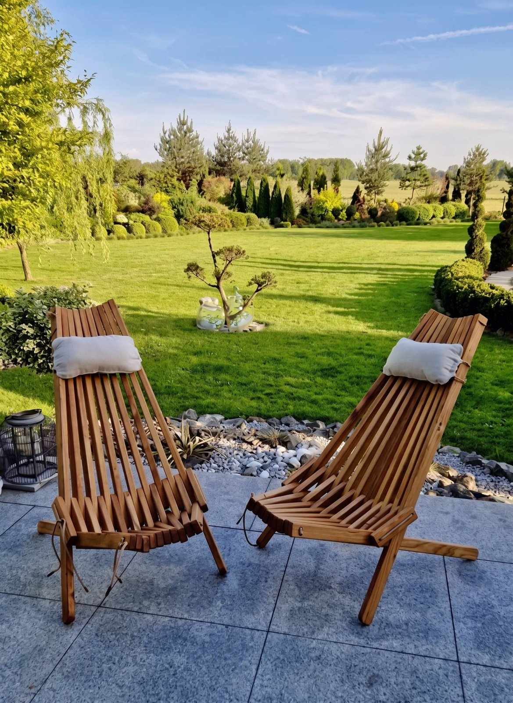
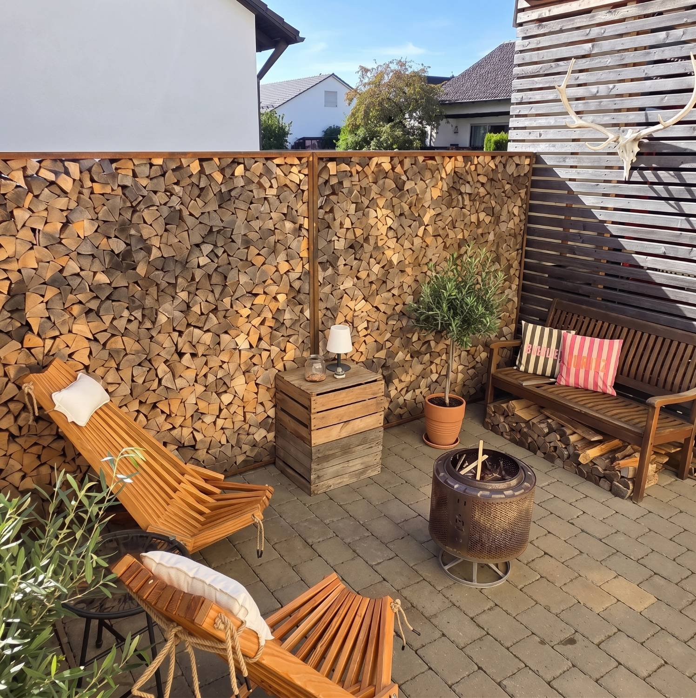
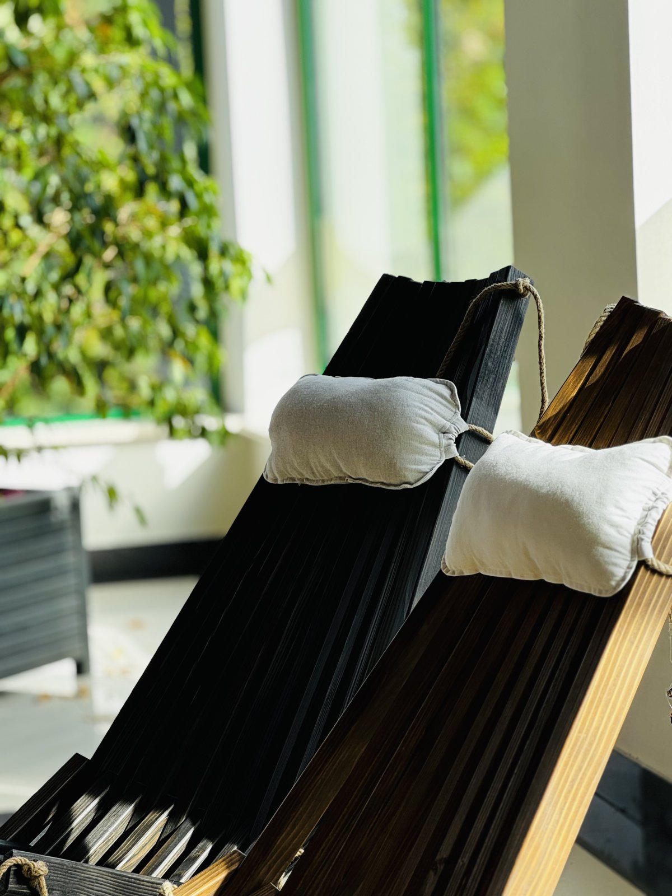
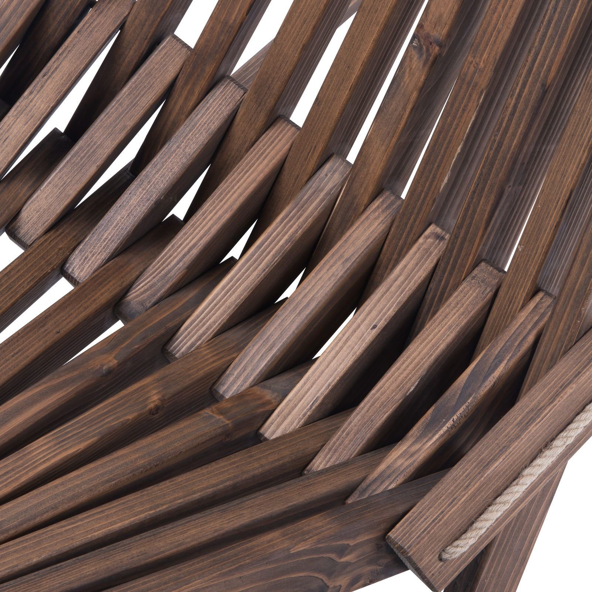
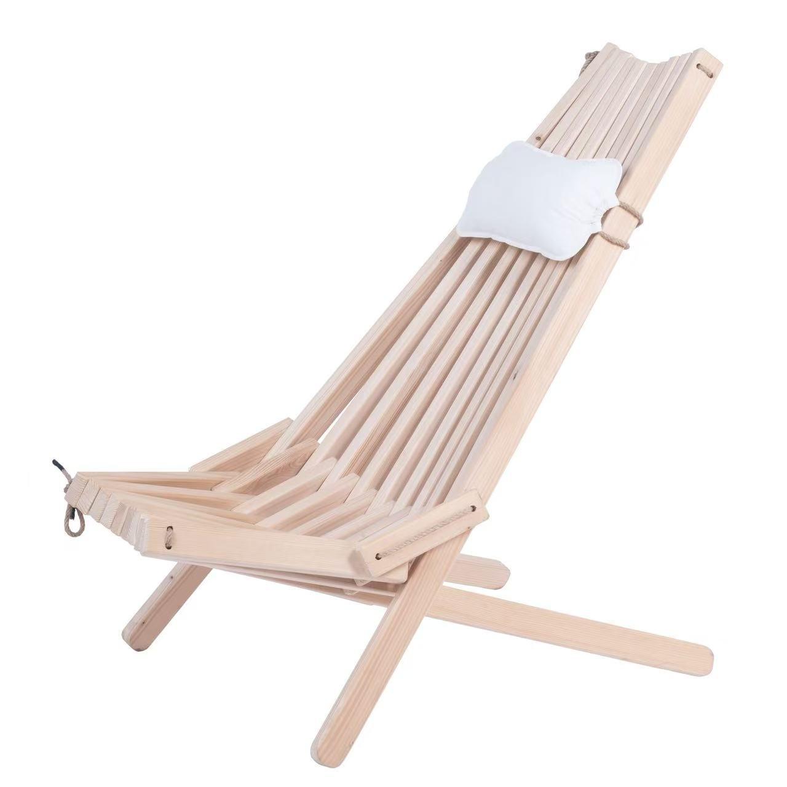

# 🎁 Leżak – prezent na święta, który czeka na maj (karuzela)

**Status:** 👀 do akceptacji Pablo
**Kiedy:** piątek 6.11.2026, 10:00 (najlepsza godzina tygodnia wg Metricool) · **Gdzie:** Instagram + Facebook, Pinterest (EN → Etsy)
**Cel:** sprzedaż leżaka jako prezentu świątecznego (299 zł, darmowa wysyłka). **Fraza (Kuba):** „leżak drewniany składany”.
**Przewaga nad Bogateco:** oni w święta sprzedają dekoracje i jutę (dodatki za 5–20 zł); my – **prezent premium na lata**, z polskiej jodły, z jasną ceną i darmową dostawą.

## Kolejność zdjęć (karuzela 4:5)
1. 
   **Tekst na zdjęciu:** „Prezent, który rozłożysz w maju”
2. 
   „…a w październiku – przy ognisku 🔥”
3. 
   „5 kolorów · poduszka w zestawie”
4. 
   „Jodła bieszczadzka z certyfikatem FSC”
5. 
   „299 zł · darmowa wysyłka · link w bio”

## Opis – Instagram
```
Prezent, który rozłożysz w maju 🎁☀️

Składany leżak FUDALI z jodły bieszczadzkiej. Rozkładasz – siedzisz. Składasz – stoi w kącie garażu do następnego sezonu.

🌲 selekcjonowana jodła z certyfikatem FSC
🪢 lina jutowa i bawełniana poduszka w zestawie
🎨 5 kolorów: jasny brąz, brązowy, ciemny brąz, grafitowy, czarny
🚚 darmowa wysyłka w Polsce

Zrobione u nas, w Głogowie Małopolskim. Bez plastiku, bez śrubek do zgubienia.

299 zł → link w bio
Kto z Was dostałby taki prezent pod choinkę? 👇

#leżak #leżakdrewniany #leżakogrodowy #meblezdrewna #mebleogrodowe #prezentnaświęta #pomysłnaprezent #prezentdlaniego #prezentdlaniej #drewno #jodła #rękodzieło #madeinpoland #taras #ogród
```

## Opis – Facebook (dłuższy, z linkiem)
```
🎁 Szukasz prezentu, który nie skończy w szufladzie?

Składany leżak FUDALI to prezent na lata: z selekcjonowanej jodły bieszczadzkiej (certyfikat FSC), z bawełnianą poduszką w zestawie, w 5 kolorach do wyboru. Waży 10 kg, składa się na płasko – zimą nie zajmuje miejsca, a w maju jest gotowy na taras.

✅ 299 zł
✅ darmowa wysyłka w Polsce
✅ roczna gwarancja + 14 dni gwarancji satysfakcji

Zamów tutaj: https://www.fudali.com.pl/sklep/lezak-ogrodowy/
```

## Pinterest (EN, link do Etsy)
- **Title:** Folding Wooden Lounge Chair – Handmade Fir Garden Chair, Perfect Christmas Gift
- **Description:** Handmade folding lounge chair from selected FSC-certified fir from the Bieszczady Mountains, Poland. Cotton pillow included, 5 colours, folds flat for winter storage. A gift they will use for years – on the patio, in the garden or by the fire pit.
- **Link:** https://www.etsy.com/listing/1821779072
- **Zdjęcie:** nr 2 (pion – najlepiej działa na Pintereście)

## Stories (3 klatki, ten sam dzień 18:00)
1. zdjęcie 6 + ankieta „Czarny 🖤 czy brąz 🤎?”
2. zdjęcie 1 + tekst „Prezent na święta, używany od maja do października”
3. zdjęcie 3 + naklejka z linkiem do sklepu

## Do potwierdzenia przez Pablo
- Czy na zdjęciu 3 jest kolor z oferty (np. „jasny brąz”), czy surowe drewno? (Jeśli surowe – podmienię na inne zdjęcie, żeby nie obiecywać koloru, którego nie ma.)
- Czy zdjęcia 1 i 2 to ogrody klientów? Jeśli tak – dopiszę „u naszych klientów” (to buduje zaufanie).
