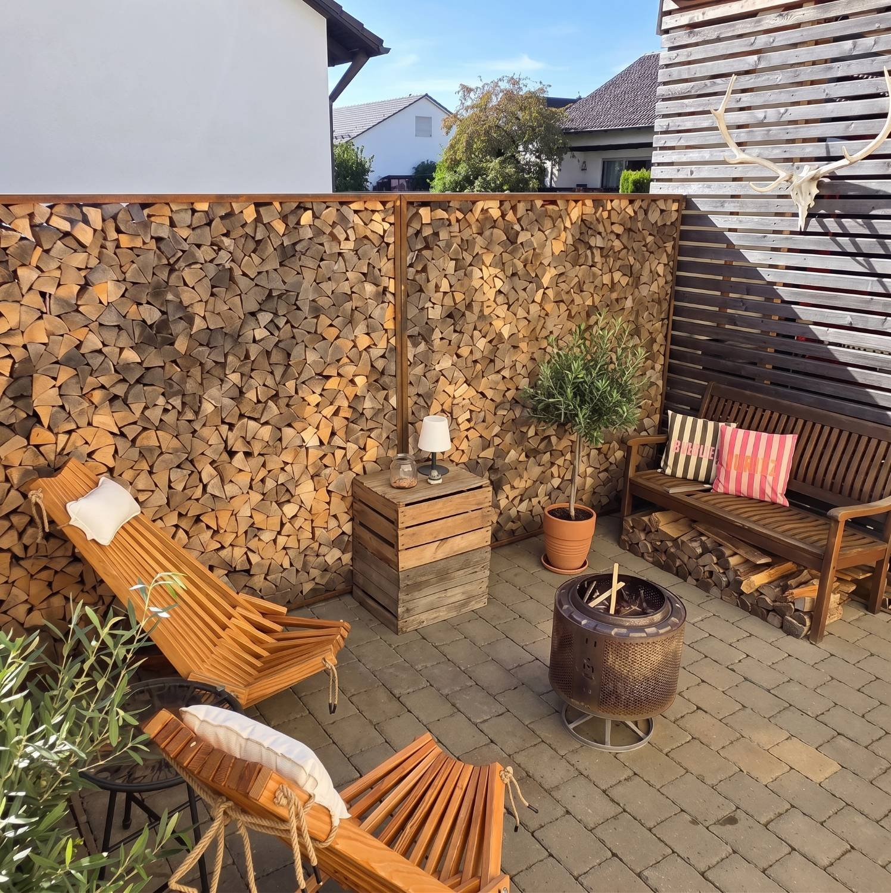

# 🔥 Długi weekend przy ognisku (jedno zdjęcie)

**Status:** 👀 do akceptacji Pablo
**Kiedy:** wtorek 10.11.2026, 18:00 (dzień przed długim weekendem 11.11) · **Gdzie:** Instagram + Facebook
**Cel:** zasięg i zapisy („zapisz na później”), miękka sprzedaż. **Fraza:** „leżak drewniany ogrodowy”.



## Opis – Instagram / Facebook
```
Kto powiedział, że sezon na taras kończy się we wrześniu? 🔥

Ognisko, koc, herbata z sokiem malinowym i leżak, z którego nie chce się wstawać. Długi weekend zapowiada się dobrze.

Składany leżak FUDALI z jodły bieszczadzkiej – 10 kg, składa się na płasko, poduszka w zestawie. 299 zł, darmowa wysyłka.

📌 Zapisz post na długi weekend i oznacz osobę, z którą siedzisz przy ognisku.

#ognisko #wieczórprzyognisku #taras #ogród #leżak #leżakdrewniany #meblezdrewna #drewno #jesień #długiweekend #madeinpoland #fudali
```

## Do potwierdzenia
- Ściana z drewna opałowego na zdjęciu – czy to nasza realizacja (drewutnia/regał na drewno)? Jeśli tak, zrobimy z tego **osobny post o drewutniach** – to temat, którego Bogateco nie sprzedaje.
