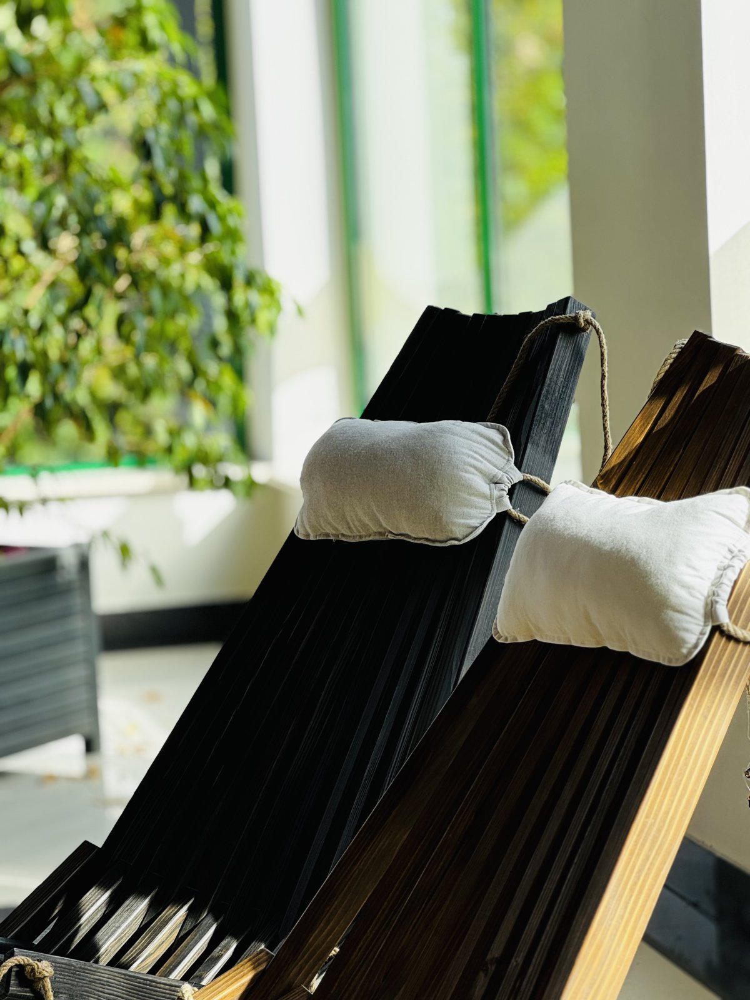
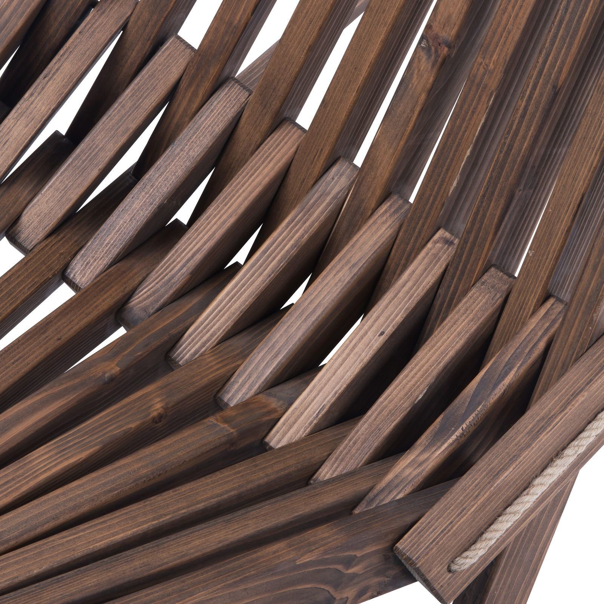
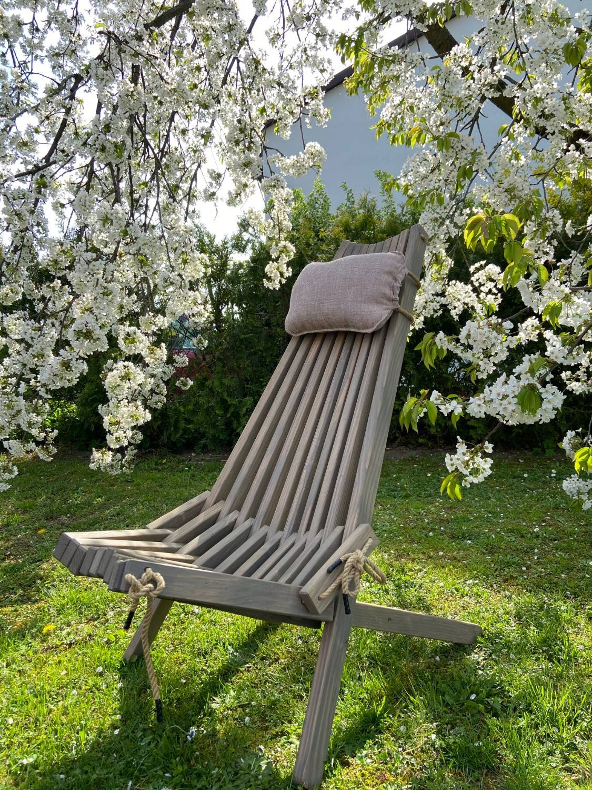
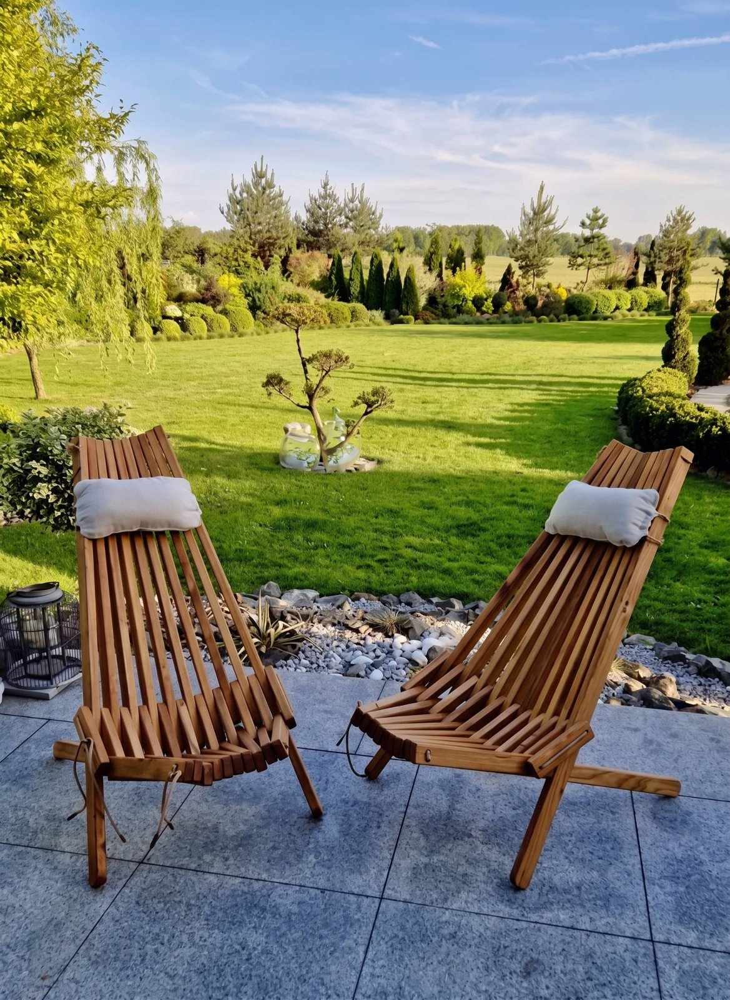

# 🎨 5 kolorów – który Twój? (karuzela + ankieta)

**Status:** 📝 szkic – czeka na potwierdzenie kolorów na zdjęciach
**Kiedy:** piątek 13.11.2026, 10:00 · **Gdzie:** Instagram + Facebook (+ ankieta w stories)
**Cel:** zaangażowanie (komentarze = zasięg) i oswojenie z wyborem koloru przed zakupem.

## Kolejność zdjęć (proszę o potwierdzenie nazw kolorów)
1.  – „czarny vs brązowy?” ← *do potwierdzenia*
2.  – „ciemny brąz” ← *do potwierdzenia*
3.  – „grafitowy” ← *do potwierdzenia (na zdjęciu wygląda na jasnoszary)*
4.  – „jasny brąz” ← *do potwierdzenia*

## Opis
```
5 kolorów, jeden problem: który wybrać? 🤔

🤍 jasny brąz – do jasnych tarasów i skandynawskich ogrodów
🤎 brązowy – klasyka, pasuje wszędzie
🟫 ciemny brąz – elegancko, przy ciemnej elewacji
🩶 grafitowy – nowoczesny, do betonu i kamienia
🖤 czarny – dla odważnych

Napisz w komentarzu numer koloru 1–5 👇 Policzymy głosy i pokażemy zwycięzcę.

Leżak z jodły bieszczadzkiej, poduszka w zestawie, 299 zł, darmowa wysyłka. Link w bio.

#leżak #leżakdrewniany #kolory #meblezdrewna #mebleogrodowe #taras #ogród #aranżacjaogrodu #madeinpoland #fudali
```

## Brakuje
- Zdjęć w kolorach „brązowy” i „grafitowy” (jeśli 04 to nie grafitowy). Najlepiej wszystkie 5 leżaków obok siebie – jedno takie zdjęcie zrobi robotę za cały post.
